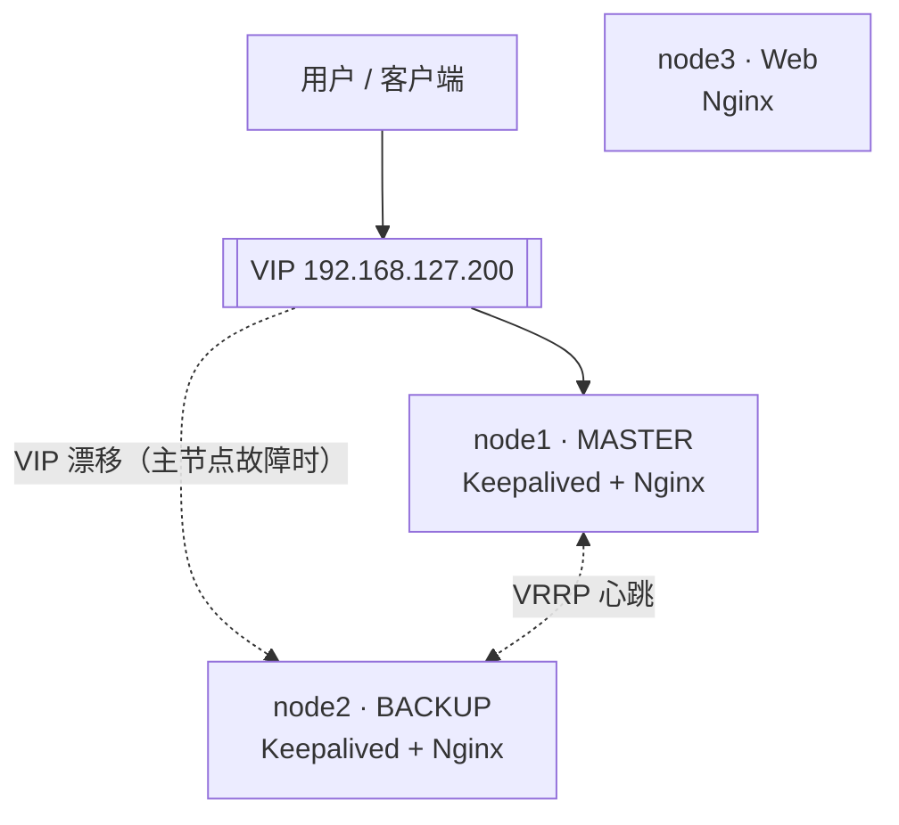

# 基于 Ansible 的 Web 集群自动化部署


使用 Ansible 实现 3 节点 Web 高可用集群的全自动化部署：一键完成环境初始化、Nginx 部署、Keepalived 主备配置及健康检查，部署耗时约 10 分钟。

## 架构



- node1 / node2 组成 lb 组：都运行 Nginx，VIP 平时落在 MASTER（node1）上，主节点故障时自动漂移到 BACKUP（node2），切换时间 < 3s。
- node3 为纯 Web 节点，运行 Nginx 提供站点服务。
- VIP 只在 `inventory/hosts.ini` 的 `[all:vars]` 中定义一处，Keepalived 模板与健康检查模块都从同一变量取值。

## 技术栈

- **Ansible** — 自动化部署与配置管理
- **Nginx** — Web 服务与反向代理
- **Keepalived** — 基于 VRRP 的 VIP 主备漂移
- **Rocky Linux 10** — 运行环境
- **Python** — 自定义 Ansible Module

## 项目结构

```text
ansible-web-cluster/
├── .github/workflows/     # CI：语法检查 + ansible-lint
├── inventory/
│   └── hosts.ini          # 节点定义与分组（VIP 也在这里统一定义）
├── roles/
│   ├── common/            # 系统初始化（软件包、防火墙、时区）
│   ├── nginx/             # Nginx 安装、主配置与站点模板下发
│   └── keepalived/        # Keepalived 主备配置（状态/优先级取自 inventory）
├── custom_module/
│   └── check_node_health.py  # 自定义健康检查 Module（VIP 由参数传入）
├── site.yml               # 主入口 Playbook（初始化 → Keepalived → 健康检查）
└── ansible.cfg
```

## 核心功能

- **一键部署**：`ansible-playbook site.yml` 完成全集群初始化
- **Jinja2 模板**：动态生成 Keepalived / Nginx 配置文件，主备节点差异化下发
- **VIP 漂移**：主节点故障后 VIP 自动切换至备节点，切换时间 < 3s
- **Handlers 热更新**：Nginx 配置变更触发 reload，零停机生效
- **自定义 Module**：Python 实现节点健康检查，输出 Nginx / Keepalived / VIP 状态

## 快速开始

### 环境要求

- Ansible 控制节点 1 台
- Rocky Linux 节点 3 台
- 控制节点到所有节点 SSH 免密登录

### 修改 inventory

```ini
# inventory/hosts.ini
[webservers]
node1 ansible_host=192.168.x.101
node2 ansible_host=192.168.x.102
node3 ansible_host=192.168.x.103

[lb]
node1 keepalived_state=MASTER keepalived_priority=100
node2 keepalived_state=BACKUP  keepalived_priority=90

[all:vars]
vip=192.168.x.200  # 改为同网段未使用的 IP，全仓库只改这一处
```

### 一键部署

```bash
ansible-playbook site.yml
```

### 验证 VIP 漂移

```bash
# 停止主节点 Keepalived
ssh root@node1 "systemctl stop keepalived"

# 确认 VIP 漂移到备节点
ssh root@node2 "ip addr show | grep <VIP>"

# 服务访问不中断
curl http://<VIP>
```

## 部署效果

```text
PLAY RECAP
node1 : ok=20  changed=5  failed=0
node2 : ok=20  changed=5  failed=0
node3 : ok=14  changed=1  failed=0
```

健康检查输出：

```text
Node: node1 | Nginx: active | Keepalived: active  | VIP: active
Node: node2 | Nginx: active | Keepalived: active  | VIP: standby
Node: node3 | Nginx: active | Keepalived: N/A     | VIP: standby
```

## 代码质量

每次 push 与 Pull Request 都会在 GitHub Actions 中自动执行：

- `ansible-playbook --syntax-check`：Playbook 语法检查
- `ansible-lint`：按官方推荐规则检查 roles 与 Playbook（当前 0 违规）

本地也可以直接运行：

```bash
pip install ansible ansible-lint
ansible-playbook -i inventory/hosts.ini site.yml --syntax-check
ansible-lint site.yml roles/ inventory/
```
